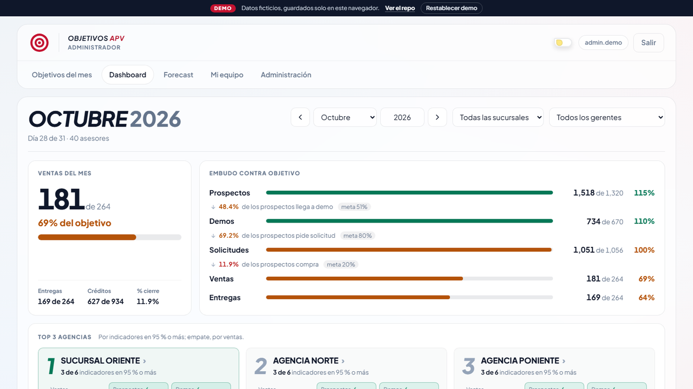
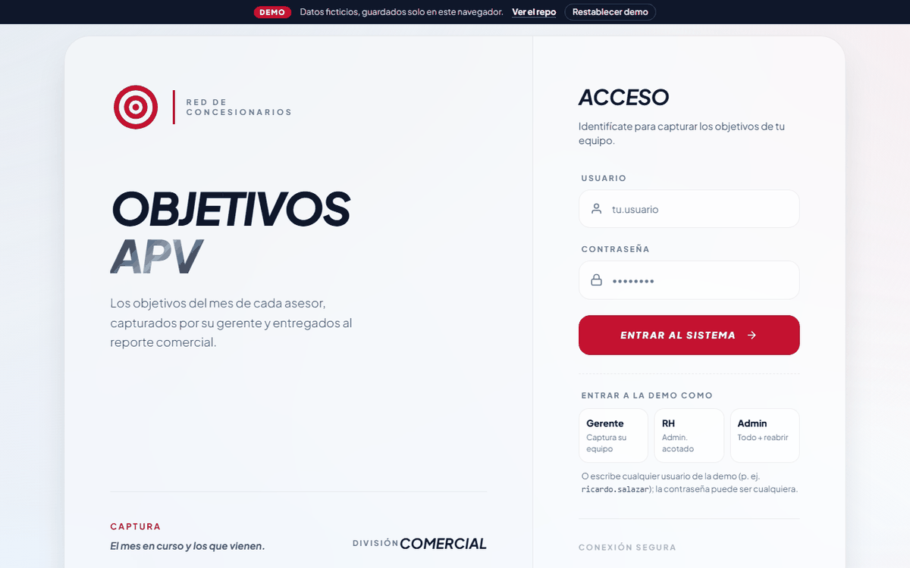
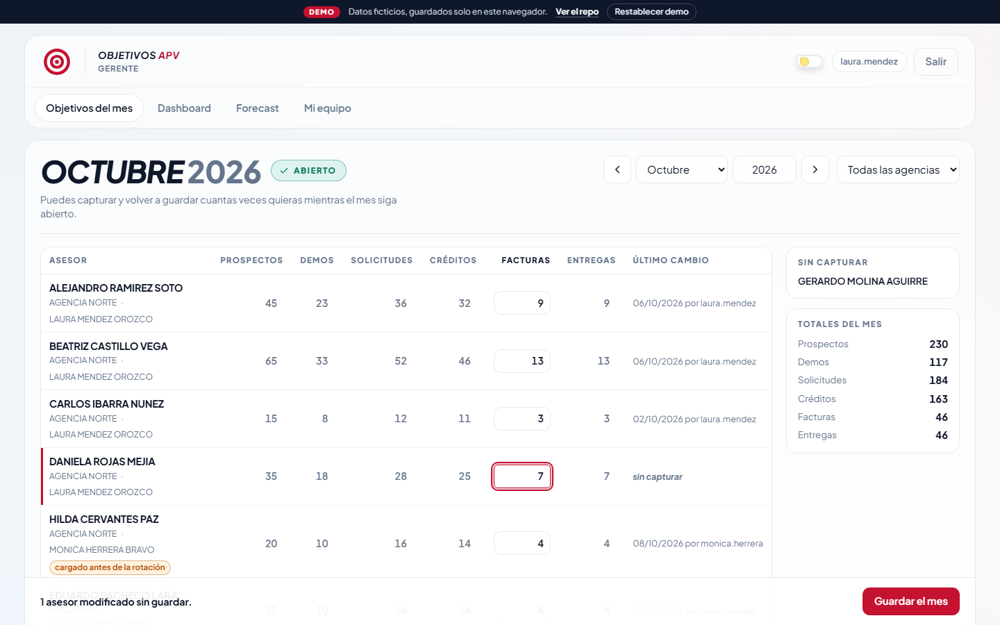
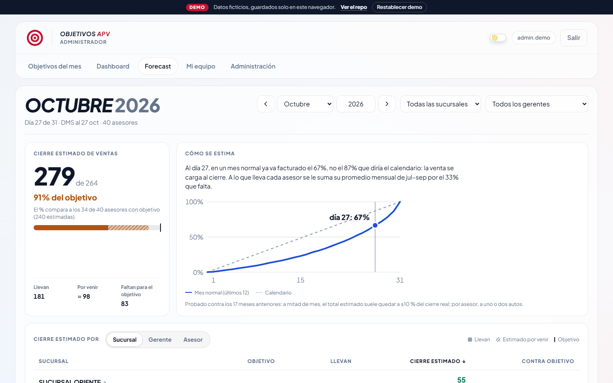
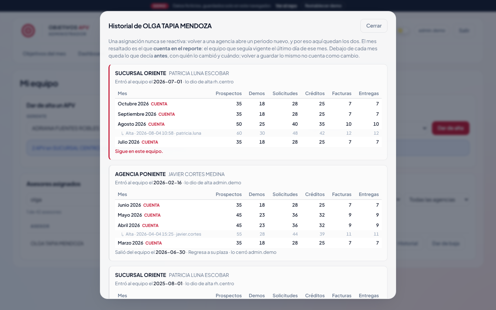
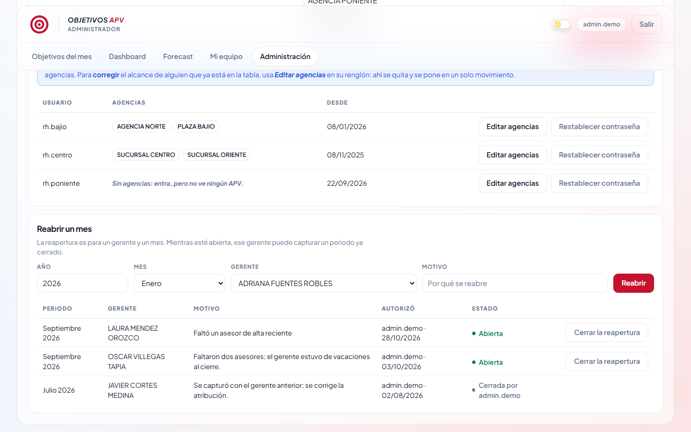
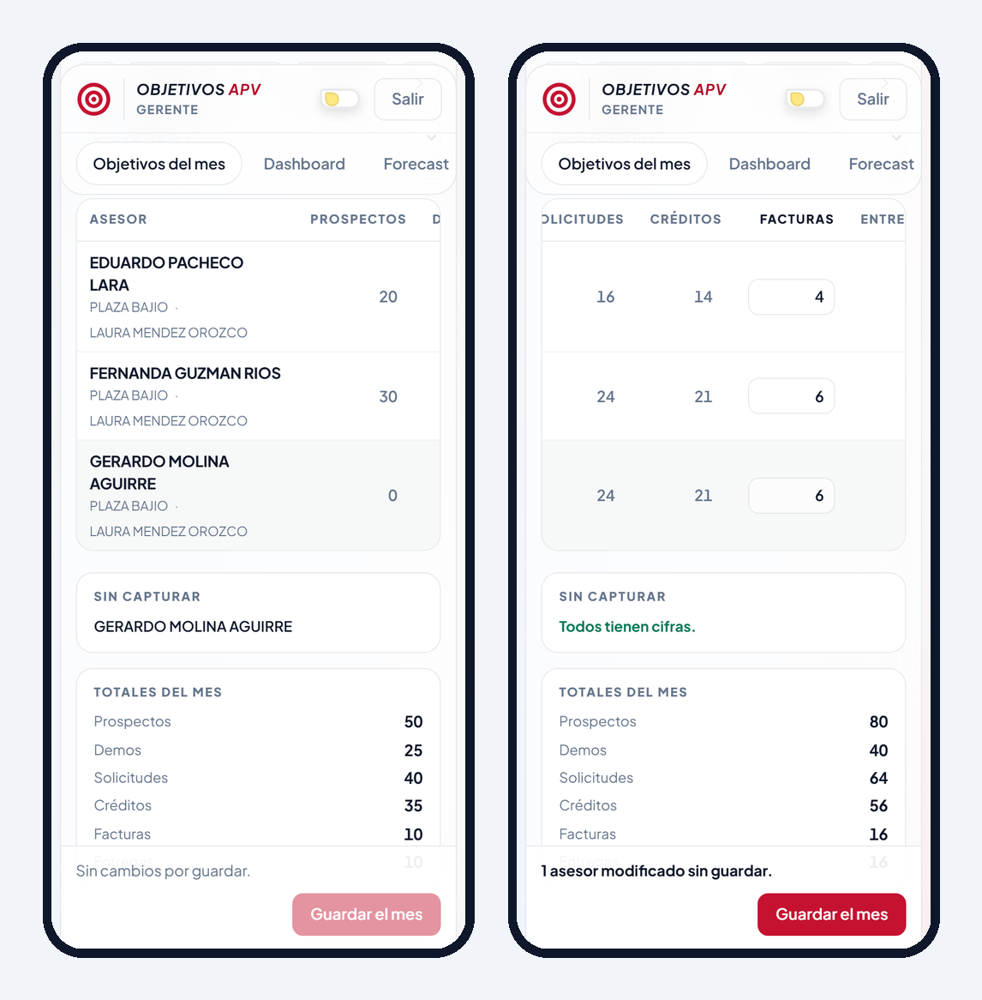
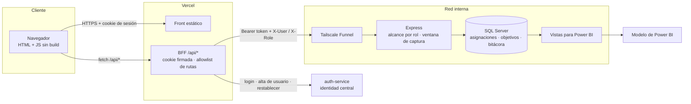

<div align="center">
  
  <h1>Objetivos APV</h1>
  <p><b>Captura mensual de objetivos por asesor de ventas (APV), para gerentes de una red de concesionarios, con entrega directa a Power BI.</b></p>
  <p>
    <a href="https://rexghidorah.github.io/objetivos-apv/"></a>
  </p>
  <p>
    
    
    
    
    
    
  </p>
</div>

## El problema

Los objetivos mensuales de cada asesor vivían en un Excel compartido que alimentaba el reporte
comercial de Power BI. El Excel no podía representar cómo funciona de verdad el piso de ventas:
un asesor que trabaja en dos agencias, dos gerentes en la misma sucursal, equipos que rotan cada
pocos meses. Se capturaba a mano, sin cierre de mes, sin rastro de quién cambió qué, y un nombre
mal escrito dejaba a un asesor en ceros en el reporte sin que nadie se enterara.

## Qué hace

- **Captura** una sola cifra por asesor (facturas). Los otros cinco rubros (prospectos, demos,
  solicitudes, créditos, entregas) se calculan al teclear y se vuelven a calcular en el servidor.
- **Cierra el mes** solo al terminar: el mes en curso y los futuros se editan, los pasados no.
  Solo un administrador **reabre** un mes, para un gerente en particular, con motivo y bitácora.
- **Conserva la historia** de cada asesor: con qué gerente y en qué agencia estuvo, mes por mes,
  y qué decía cada objetivo antes de cada cambio.
- **Separa permisos por rol**: el gerente captura a los suyos, RH administra el equipo de sus
  agencias, el admin ve todo. El servidor aplica la regla; la pantalla solo la refleja.
- **Da accesos** sin abrir SQL: registrar a un gerente crea su usuario en la identidad central
  con una contraseña provisional que se muestra una sola vez.
- **Compara objetivo contra real** (Dashboard por sucursal, gerente o asesor, con los autos
  facturados de cada uno) y **estima el cierre del mes** (Forecast).
- **Entrega a Power BI** por medio de vistas SQL, sin cambiar las relaciones ni las medidas del modelo.

## Demo



| | |
|---|---|
|  |  |
| **Captura del mes.** Una cifra por asesor; el resto se calcula. El renglón marcado se cargó antes de una rotación de gerente. | **Forecast.** Lo que lleva cada asesor más su promedio, ponderado por la curva real de cierre de mes, no por el calendario. |
|  |  |
| **Historial.** El asesor salió de su agencia y volvió: tres periodos, ninguno reactivado. Debajo de cada mes, lo que decía antes. | **Reabrir un mes.** Solo el admin, para un gerente y un mes, con motivo. Queda el rastro de quién autorizó y quién cerró. |

<p align="center"><br>
<sub>Desde el teléfono, sin VPN: la reja se desliza hasta la columna de facturas y el pie de guardado queda fijo.</sub></p>

La demo corre completa en el navegador con datos ficticios (5 agencias, 8 gerentes, 41 asesores,
14 meses de objetivos). Se entra como **Gerente**, **RH** o **Admin** con un clic; lo capturado se
guarda en `localStorage` y el botón *Restablecer demo* vuelve al estado inicial.

## Arquitectura



- El navegador nunca ve el backend ni el token: solo habla con el BFF de Vercel, que firma una
  cookie de sesión `HttpOnly` y reenvía a Express con un token de servicio.
- La identidad (usuarios, contraseñas, rol por app) vive en un servicio central compartido por
  varias apps internas: [**auth-service**](https://github.com/RexGhidorah/auth-service). Esta app
  no tiene tabla de usuarios; decide **qué alcanza** cada quien, no **quién es**.
- Express corre en la red interna, junto a SQL Server, y se publica con Tailscale Funnel: los
  gerentes capturan desde el teléfono sin VPN y el puerto de la base nunca se expone.

## Decisiones de ingeniería

- **Una asignación nunca se reactiva.** La relación asesor–gerente–agencia es una tabla de
  periodos con `vigente_desde` / `vigente_hasta`. Rotar o volver a una agencia **inserta** un
  renglón nuevo. La v1 (ASP.NET Razor Pages, reescrita en esta versión) reactivaba el renglón
  anterior y perdía la respuesta a "¿de quién era este asesor en marzo?". Un asesor puede tener
  varias asignaciones vivas (una por agencia); lo que la base impide, con un índice único
  filtrado, es **dos gerentes vivos en la misma agencia**, porque el objetivo tiene grano
  (asesor, agencia, mes) y quedaría sin dueño.
- **El gerente no tiene columna de sucursal.** Varios gerentes conviven en una agencia y uno
  puede llevar tres; la agencia es del par asesor–gerente. Qué agencias "son" de un gerente lo
  dice el padrón de nómina, no un campo que alguien mantenga a mano, y por eso crear una
  asignación no puede usarse para fabricarse permisos sobre el gerente de otra agencia.
- **El objetivo guarda una foto del gerente.** Rotar a un asesor a media captura no reescribe lo
  ya cargado: el objetivo del mes sigue a nombre de quien lo capturó (es lo que reporta Power BI)
  y la reja lo marca como *cargado antes de la rotación*. Un trigger escribe cada cambio en una
  bitácora; la pantalla muestra solo los cambios reales, no cada clic en "Guardar".
- **Los permisos se aplican en el servidor, renglón por renglón.** El alcance sale de la identidad
  del token, nunca del cuerpo de la petición, y vive en un solo módulo con pruebas (admin / RH
  acotado a sus agencias / gerente acotado a los suyos; un rol desconocido cae al más
  restringido). La ventana de captura se re-evalúa en cada guardado con el reloj del servidor:
  cambiarle la fecha al equipo no abre un mes cerrado. Ocultar un botón es cortesía; el 403 lo
  pone el backend.
- **BFF + token en lugar de exponer la API.** El BFF tiene una allowlist explícita: publicar una
  ruta nueva del backend es un acto deliberado, no un efecto de agregarla. Express se niega a
  arrancar sin token, porque el Funnel lo deja alcanzable desde internet. Las contraseñas que se
  generan al dar un acceso son provisionales, de 9 caracteres sin ambiguos (`0/O`, `1/l`), se
  muestran una vez en un diálogo modal y nunca se guardan en claro.
- **Compatibilidad con Power BI sin tocar el modelo.** La columna `ASESOR` del Excel era la llave
  del lado *uno* de cuatro relaciones; los objetivos, en cambio, se repiten por mes y agencia.
  Se entregan vistas con trabajos distintos: una dimensión de un renglón por asesor, una tabla de
  hechos (asesor × agencia × mes) y una vista de compatibilidad con **las mismas 9 columnas del
  Excel**, para cambiar el origen de la tabla sin tocar relaciones ni medidas. La normalización
  del nombre (mayúsculas, sin `Ñ`, sin espacios dobles) la hace la base en una columna calculada
  con índice único, en vez de Power Query.
- **Forecast con curva de cierre, probado contra la historia.** La venta se carga al final del
  mes (al día 20 va ~50 %, no 67 %). El estimado suma a lo que lleva cada asesor su promedio de
  tres meses por la fracción que falta según la curva de los últimos 12 meses. En un backtest de
  17 meses quedó a ±10 % del cierre a mitad de mes, contra un 30 % de error de la regla de tres.
  Para meses cerrados reconstruye lo que habría estimado cada día, solo con lo que existía ese día.

## Stack

| Capa | Tecnología |
|---|---|
| Frontend | HTML + CSS + JavaScript sin framework ni build (tipado con JSDoc + `tsc --noEmit`) |
| BFF | Funciones serverless de Vercel (Node.js), cookie de sesión firmada |
| Backend | Node.js + Express, `mssql`, cache en memoria para fuentes externas |
| Base de datos | SQL Server: índices únicos filtrados, columnas calculadas persistidas, triggers, vistas |
| Identidad | [auth-service](https://github.com/RexGhidorah/auth-service) (servicio central, scrypt) |
| Red | Tailscale Funnel entre Vercel y la red interna |
| Analítica | Power BI sobre vistas SQL |
| Pruebas | `node:test` (alcance, ventana, fórmula, forecast), pruebas de humo y de borde contra SQL Server real, Playwright para la demo |

## Correr la demo localmente

```bash
npx serve docs
# o bien
python -m http.server 8000 --directory docs
```

Abre la URL que imprime el servidor y elige un rol. No hay backend: `docs/demo/mock.js`
intercepta `fetch('/api/...')` y responde con la misma forma de JSON que el BFF real, sobre datos
generados en `docs/demo/datos.js`.

---
<sub>🔒 Proyecto real en producción dentro de una red de concesionarios. El código de negocio
es privado; este repo contiene la documentación y una demo con datos ficticios.</sub>
